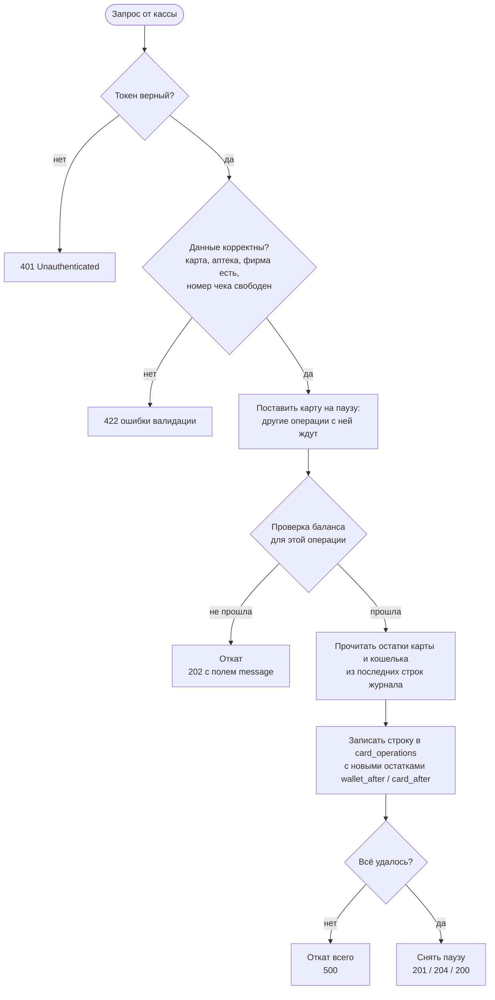
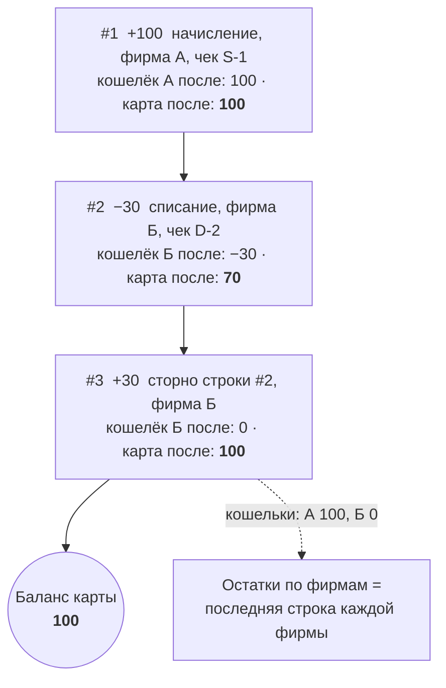
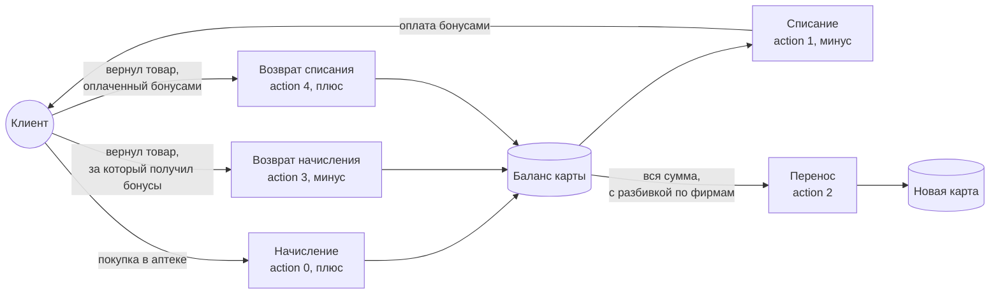
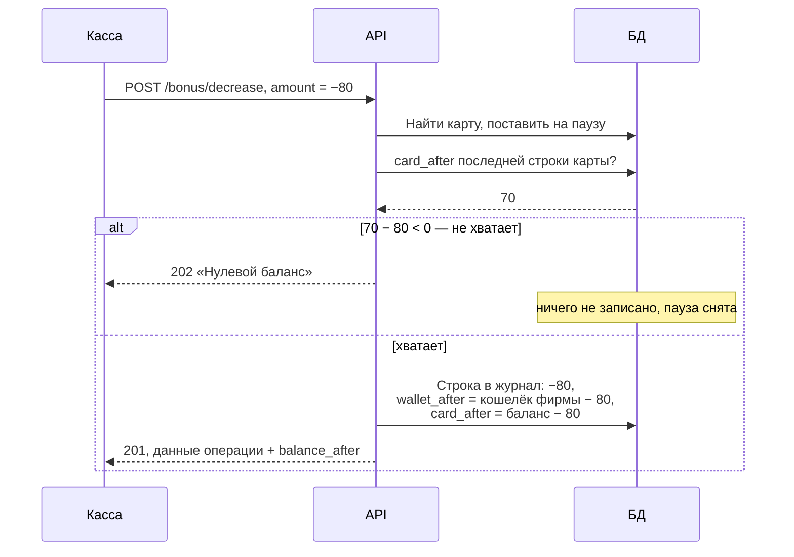
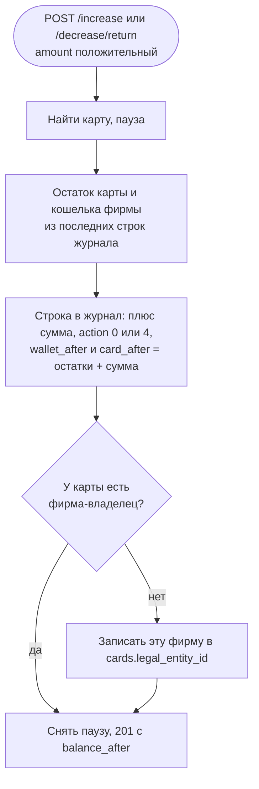
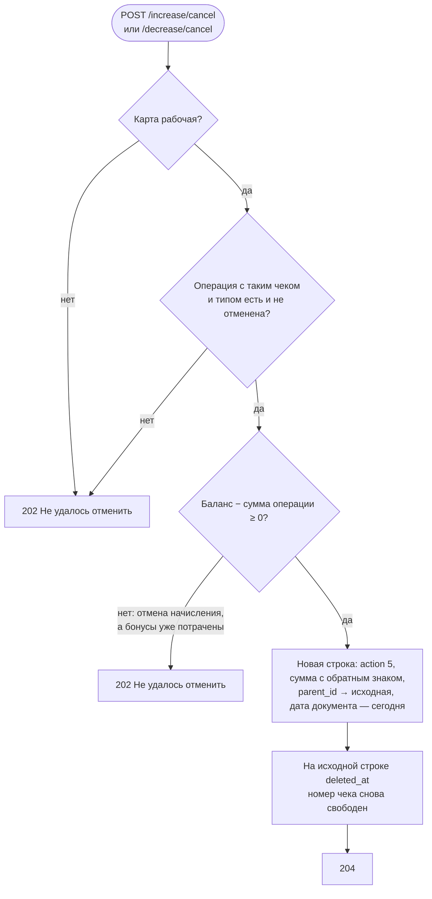
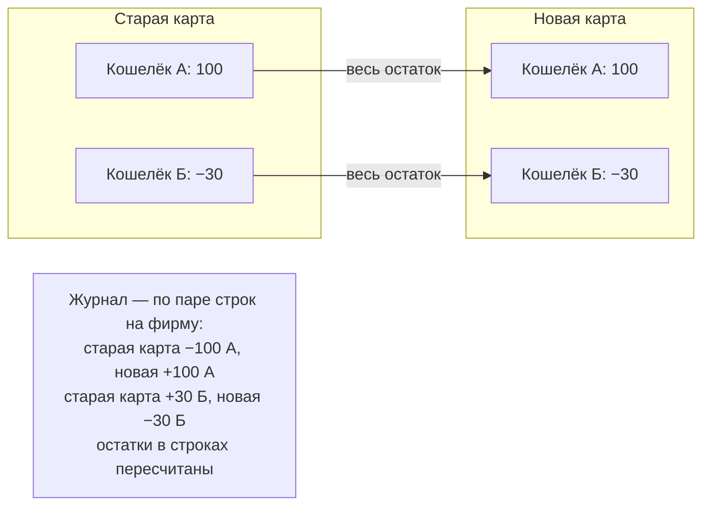
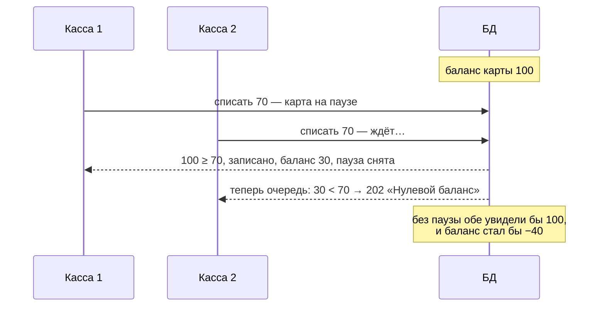
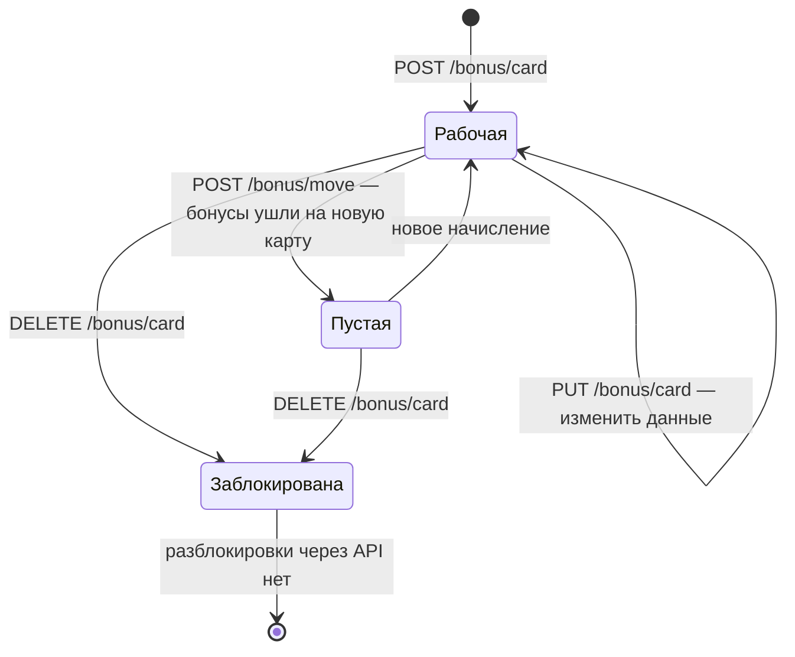

# Схемы операций с балансом
> **Примечание (ноябрь 2026):** ветки «202 Нулевой баланс» на схемах устарели — баланс может уходить в минус, операции проводятся на полную сумму.

Графическое дополнение к документу [Как работают операции с бонусами](09-algoritmy-operatsij.md). Схемы в формате Mermaid: GitHub, GitLab, VS Code (с расширением Markdown Preview Mermaid) и большинство редакторов показывают их как картинки.

## 1. Общий путь любой операции

Так проходит каждый запрос, который меняет баланс: начисление, списание, возвраты, отмена, перенос.

## 2. Как устроен баланс: журнал с остатками

Каждая строка журнала хранит остаток после себя — по кошельку фирмы и по карте. Баланс карты — `card_after` последней строки.

Минус в кошельке фирмы Б (строка #2) — нормально: Б отдала товар за бонусы, которые раздавала А. Это основа для взаиморасчётов между фирмами.

## 3. Какие операции куда двигают бонусы

## 4. Списание: проверка и отказ

## 5. Начисление и возврат списания

Обе операции прибавляют бонусы, проверка баланса для них формальная.

## 6. Отмена операции: когда нельзя

Пример: начислили 100, клиент потратил 80, осталось 20. Отменить начисление на 100 нельзя (20 − 100 < 0). Отменить списание на 80 можно: баланс станет 100.

## 7. Перенос баланса на другую карту

После переноса старая карта остаётся рабочей с нулём. Заблокировать её — отдельный запрос `DELETE /bonus/card/{short_code}`.

## 8. Две кассы одновременно: зачем пауза

## 9. Жизненный цикл карты

