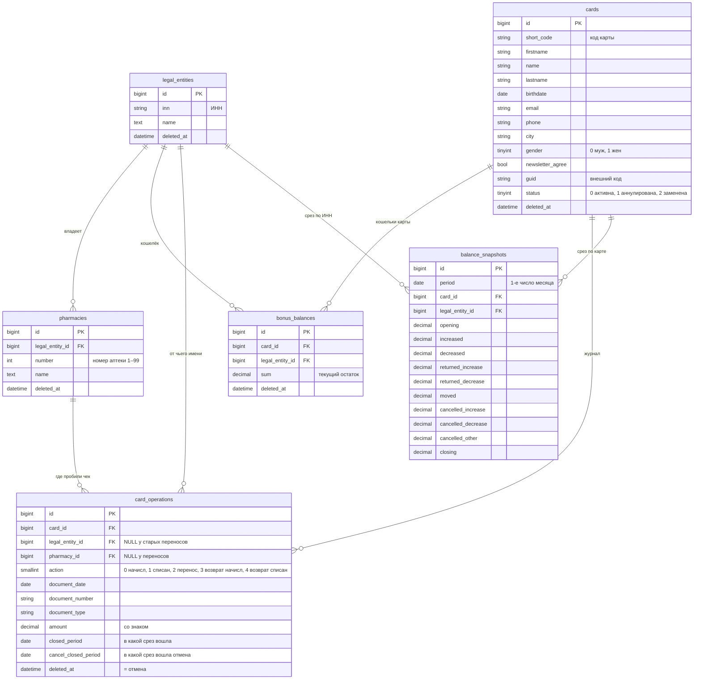
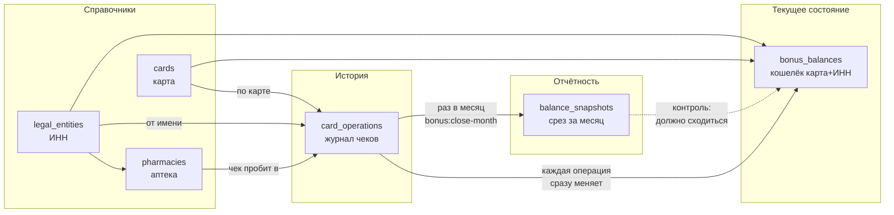

# Схема базы данных

Все таблицы проекта, их поля, ключи и связи. Короткое описание полей — в [docs/04](04-baza-dannyh.md), здесь — полная картина. Схемы в формате Mermaid (GitHub и большинство редакторов рисуют их сами).

## 1. Общая картина

Во всех таблицах есть `created_at`, `updated_at`; везде, где указан `deleted_at`, используется мягкое удаление (строка остаётся, ставится дата).

## 2. Таблицы

### 2.1. Справочники

**`legal_entities` — юридические лица (ИНН).** Владельцы аптек. Бонусы на карте учитываются в разрезе юрлица: кто начислил — у того на карте и «лежит».

| Поле | Тип | Примечание |
|:--|:--|:--|
| `id` | bigint | |
| `inn` | varchar(30) | индекс (уникальность снята миграцией 2022-09-07 — ИНН может повторяться) |
| `name` | text | |

**`pharmacies` — аптеки.** Точки продаж. Каждая принадлежит одному юрлицу.

| Поле | Тип | Примечание |
|:--|:--|:--|
| `id` | bigint | |
| `legal_entity_id` | bigint FK → legal_entities | |
| `number` | int | номер аптеки, индекс; в API допускается 1–99 |
| `name` | text | |

**`cards` — бонусные карты и их владельцы.**

| Поле | Тип | Примечание |
|:--|:--|:--|
| `id` | bigint | |
| `short_code` | varchar | код карты, по нему работают кассы; индекс |
| `firstname`, `name`, `lastname` | varchar | имя, фамилия, отчество |
| `birthdate` | date | |
| `email`, `phone`, `city` | varchar | `phone` — индекс (поиск карты по телефону) |
| `gender` | tinyint | 0 — муж, 1 — жен |
| `newsletter_agree` | bool | |
| `guid` | varchar | внешний идентификатор (из 1С) |
| `status` | tinyint | 0 — активна, 1 — аннулирована, 2 — заменена |

### 2.2. Рабочие данные

**`bonus_balances` — кошельки.** Текущий остаток по паре *карта + юрлицо*. Баланс карты = сумма её кошельков. Меняется при каждой операции (см. [docs/09](09-algoritmy-operatsij.md)).

| Поле | Тип | Примечание |
|:--|:--|:--|
| `id` | bigint | |
| `card_id` | bigint FK → cards | |
| `legal_entity_id` | bigint FK → legal_entities | |
| `sum` | decimal(8,2) | остаток; у отдельного кошелька может быть отрицательным, сумма по карте — нет |

Логически пара `(card_id, legal_entity_id)` уникальна, но ограничения в базе нет — только индекс.

**`card_operations` — журнал движений.** Одна строка на начисление, списание, возврат; две на каждое юрлицо при переносе. Первичный источник правды для отчётов.

| Поле | Тип | Примечание |
|:--|:--|:--|
| `id` | bigint | |
| `card_id` | bigint FK → cards | |
| `legal_entity_id` | bigint FK, NULL | NULL только у переносов, сделанных до ноября 2026 |
| `pharmacy_id` | bigint FK, NULL | NULL у переносов |
| `action` | smallint | 0 начисление, 1 списание, 2 перенос, 3 возврат начисления, 4 возврат списания |
| `document_date` | date | дата чека — по ней операция относится к месяцу |
| `document_number` | varchar | индекс; вместе с `document_type` и картой идентифицирует чек при отмене |
| `document_type` | varchar | |
| `amount` | decimal(8,2) | со знаком: начисление `+`, списание `−`, возврат начисления `−`, возврат списания `+`, перенос `−` на источнике и `+` на приёмнике |
| `closed_period` | date, NULL | первое число месяца, в срез которого вошла операция |
| `cancel_closed_period` | date, NULL | первое число месяца, в срез которого вошла её отмена |
| `deleted_at` | datetime, NULL | заполнено — операция отменена; дата отмены |

Индексы: `(card_id, legal_entity_id)`, `document_number`, `(closed_period, document_date)`, `(cancel_closed_period, deleted_at)`.

**`balance_snapshots` — срезы на конец месяца.** Одна строка на *месяц × карта × юрлицо*. Строится из `card_operations` командой `bonus:close-month`, после записи не меняется. Подробно — [docs/14](14-zakrytie-mesyatsa.md).

| Поле | Тип | Примечание |
|:--|:--|:--|
| `period` | date | первое число месяца |
| `card_id` | bigint FK → cards | |
| `legal_entity_id` | bigint FK, NULL | NULL — строка со старыми переносами без юрлица |
| `opening` … `closing` | decimal(12,2) | сальдо и обороты, формула в docs/14 |

Уникальный ключ `(period, card_id, legal_entity_id)`, индекс `(period, legal_entity_id)`.

### 2.3. Служебные таблицы Laravel / Passport

Созданы стандартными миграциями, бизнес-данных не содержат.

| Таблица | Зачем |
|:--|:--|
| `oauth_clients` | клиенты API (кассы, 1С); тут лежат `client_id` и хэш секрета |
| `oauth_access_tokens` | выданные токены; проверяются при каждом запросе |
| `oauth_refresh_tokens`, `oauth_auth_codes`, `oauth_device_codes` | другие сценарии OAuth, в проекте не используются |
| `users`, `password_resets`, `personal_access_tokens` | стандартная авторизация Laravel, пользователей нет |
| `failed_jobs` | упавшие фоновые задачи; очередей нет |
| `migrations` | какие миграции выполнены |

## 3. Как данные связаны между собой

Читать так:

1. Касса присылает чек: карта (`cards`), аптека (`pharmacies`) и её юрлицо (`legal_entities`) определяют, **кому** и **от кого** движение.
2. Чек записывается строкой в **`card_operations`** и в той же транзакции меняет `sum` в **`bonus_balances`** у кошелька *эта карта + это юрлицо*.
3. Баланс карты для кассы — сумма её кошельков в `bonus_balances`.
4. Раз в месяц журнал сворачивается в **`balance_snapshots`**. Срез считается только из журнала, поэтому его можно сверить с `bonus_balances` — если не сходится, значит, журнал и остатки где-то разошлись.

## 4. Кардинальности

| Связь | Тип |
|:--|:--|
| юрлицо → аптеки | 1 : много |
| юрлицо → кошельки | 1 : много |
| карта → кошельки | 1 : много (по одному на юрлицо) |
| карта → операции | 1 : много |
| аптека → операции | 1 : много |
| юрлицо → операции | 1 : много |
| карта + юрлицо + месяц → срез | 1 : 1 |

Внешние ключи без каскадного удаления: удалить карту или юрлицо, по которым есть операции, база не даст. Удаление в проекте везде мягкое (`deleted_at`).

## 5. Что считается источником правды

| Вопрос | Откуда брать |
|:--|:--|
| Сколько бонусов на карте сейчас | `SUM(bonus_balances.sum)` по карте |
| Сколько бонусов юрлица на карте сейчас | `bonus_balances.sum` кошелька |
| Что происходило по карте | `card_operations` (включая `deleted_at` — отменённые) |
| Остаток/обороты на конец закрытого месяца | `balance_snapshots` |
| Остаток на произвольную дату в прошлом | ближайший срез до даты + операции из `card_operations` от среза до даты |
