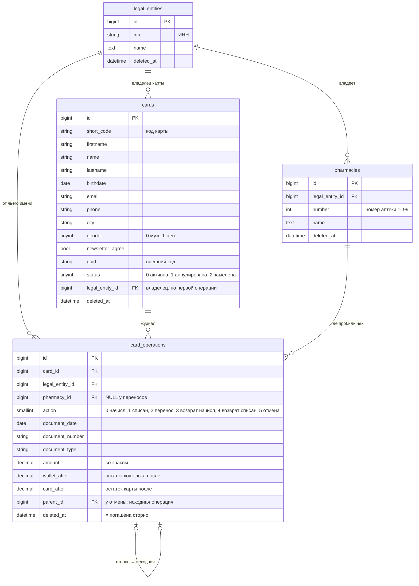
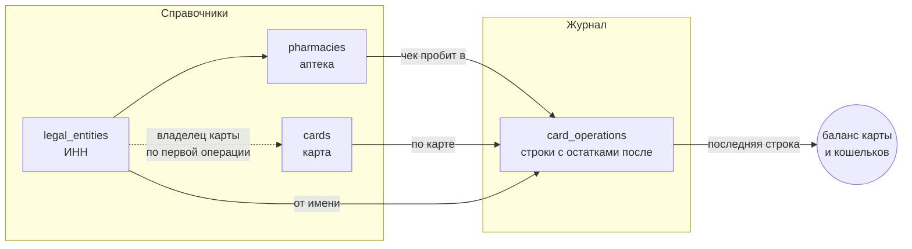

# Схема базы данных

Все 4 бизнес-таблицы проекта, их поля, ключи и связи. Короткое описание полей — в [docs/04](04-baza-dannyh.md), здесь — полная картина. Схемы в формате Mermaid (GitHub и большинство редакторов рисуют их сами).

## 1. Общая картина

Во всех таблицах есть `created_at`, `updated_at`. В справочниках `deleted_at` — мягкое удаление (строка остаётся, ставится дата). В `card_operations` `deleted_at` — пометка «операция отменена»: строка **не исключается** из выборок и остаётся частью цепочки остатков.

## 2. Таблицы

### 2.1. Справочники

**`legal_entities` — юридические лица (ИНН).** Владельцы аптек. Бонусы на карте учитываются в разрезе юрлица: кто начислил — у того на карте и «лежит».

| Поле | Тип | Примечание |
|:--|:--|:--|
| `id` | bigint | |
| `inn` | varchar(30) | индекс (уникальность снята миграцией 2022-09-07 — ИНН может повторяться) |
| `name` | text | |

**`pharmacies` — аптеки.** Точки продаж. Каждая принадлежит одному юрлицу.

| Поле | Тип | Примечание |
|:--|:--|:--|
| `id` | bigint | |
| `legal_entity_id` | bigint FK → legal_entities | |
| `number` | int | номер аптеки, индекс; в API допускается 1–99 |
| `name` | text | |

**`cards` — бонусные карты и их владельцы.**

| Поле | Тип | Примечание |
|:--|:--|:--|
| `id` | bigint | |
| `short_code` | varchar | код карты, по нему работают кассы; индекс |
| `firstname`, `name`, `lastname` | varchar | имя, фамилия, отчество |
| `birthdate` | date | |
| `email`, `phone`, `city` | varchar | `phone` — индекс (поиск карты по телефону) |
| `gender` | tinyint | 0 — муж, 1 — жен |
| `newsletter_agree` | bool | |
| `guid` | varchar | внешний идентификатор (из 1С) |
| `status` | tinyint | 0 — активна, 1 — аннулирована, 2 — заменена |
| `legal_entity_id` | bigint FK, NULL | юрлицо-владелец: записывается при первой операции по карте |

### 2.2. Журнал

**`card_operations` — журнал движений.** Одна строка на начисление, списание, возврат; две на каждое юрлицо при переносе. Первичный источник правды для отчётов.

| Поле | Тип | Примечание |
|:--|:--|:--|
| `id` | bigint | |
| `card_id` | bigint FK → cards | |
| `legal_entity_id` | bigint FK, NULL | заполняется всегда; nullable оставлен как допуск схемы |
| `pharmacy_id` | bigint FK, NULL | NULL у переносов |
| `action` | smallint | 0 начисление, 1 списание, 2 перенос, 3 возврат начисления, 4 возврат списания, 5 отмена (сторно) |
| `document_date` | date | дата чека — по ней операция относится к месяцу; у сторно — день отмены |
| `document_number` | varchar | индекс; вместе с `document_type` и картой идентифицирует чек при отмене |
| `document_type` | varchar | |
| `amount` | decimal(12,2) | со знаком: начисление `+`, списание `−`, возврат начисления `−`, возврат списания `+`, перенос `−` на источнике и `+` на приёмнике, сторно — знак, обратный исходной |
| `wallet_after` | decimal(12,2) | остаток кошелька (эта карта + это юрлицо) после операции |
| `card_after` | decimal(12,2) | остаток карты после операции; **баланс карты = `card_after` последней строки** |
| `parent_id` | bigint FK → card_operations, UNIQUE, NULL | у сторно — отменённая операция; уникальность = отменить можно один раз |
| `deleted_at` | datetime, NULL | заполнено — операция погашена сторно; дата отмены |

Индексы: `(card_id, id)` — последняя строка карты; `(card_id, legal_entity_id, id)` — последняя строка кошелька; `document_number`; `parent_id` уникальный.

Инвариант: `card_after` каждой строки = `card_after` предыдущей строки этой карты (по `id`) + `amount`; то же для `wallet_after` в пределах кошелька. Проверяется командой `bonus:ledger-check`.

### 2.3. Служебные таблицы Laravel / Passport

Созданы стандартными миграциями, бизнес-данных не содержат.

| Таблица | Зачем |
|:--|:--|
| `oauth_clients` | клиенты API (кассы, 1С); тут лежат `client_id` и хэш секрета |
| `oauth_access_tokens` | выданные токены; проверяются при каждом запросе |
| `oauth_refresh_tokens`, `oauth_auth_codes`, `oauth_device_codes` | другие сценарии OAuth, в проекте не используются |
| `users`, `password_resets`, `personal_access_tokens` | стандартная авторизация Laravel, пользователей нет |
| `failed_jobs` | упавшие фоновые задачи; очередей нет |
| `migrations` | какие миграции выполнены |

## 3. Как данные связаны между собой

Читать так:

1. Касса присылает чек: карта (`cards`), аптека (`pharmacies`) и её юрлицо (`legal_entities`) определяют, **кому** и **от кого** движение.
2. Чек записывается строкой в **`card_operations`**; в строку сразу пишутся новые остатки карты и кошелька (предыдущие + сумма).
3. Баланс карты для кассы — `card_after` последней строки. Остатки по юрлицам — `wallet_after` последней строки каждого юрлица.
4. Отмена — новая строка `action 5` с обратной суммой; исходная получает `deleted_at`, но остаётся в цепочке.

## 4. Кардинальности

| Связь | Тип |
|:--|:--|
| юрлицо → аптеки | 1 : много |
| юрлицо → карты (владелец) | 1 : много |
| операция → сторно | 1 : 0..1 |
| карта → операции | 1 : много |
| аптека → операции | 1 : много |
| юрлицо → операции | 1 : много |

Внешние ключи без каскадного удаления: удалить карту или юрлицо, по которым есть операции, база не даст. Удаление справочников мягкое (`deleted_at`); строки журнала не удаляются никогда.

## 5. Что считается источником правды

| Вопрос | Откуда брать |
|:--|:--|
| Сколько бонусов на карте сейчас | `card_after` последней строки `card_operations` по карте |
| Сколько бонусов юрлица на карте сейчас | `wallet_after` последней строки по карте и юрлицу |
| Что происходило по карте | все строки `card_operations` по карте; отменённые — с `deleted_at`, их сторно — `action 5` с `parent_id` |
| Остаток на момент времени в прошлом | `card_after` последней строки с `created_at` до этого момента |
| Обороты за месяц по юрлицу | `SUM(amount)` по `legal_entity_id`, `action` и `document_date` в месяце |
