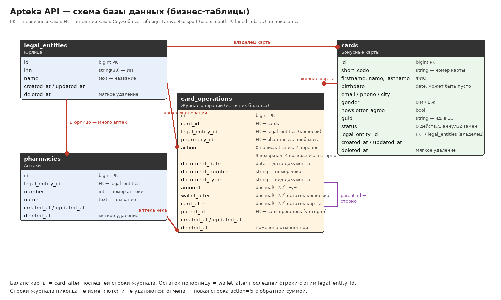
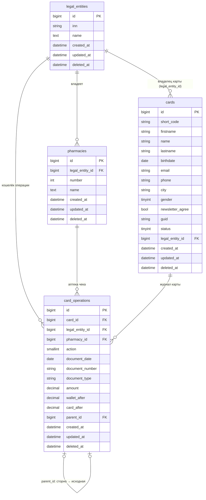

# Полное описание базы данных и логики работы

Документ для заказчика и интегратора 1С: все таблицы базы, схема связей и описание того, как бонусы считаются после перехода на журнал. Актуально для `main` после PR #16 (ноябрь 2026). Более короткие версии — [docs/04](04-baza-dannyh.md) и [docs/15](15-shema-bazy-dannyh.md); алгоритмы по каждому запросу API — [docs/09](09-algoritmy-operatsij.md).

---

## 1. Схема базы данных

Та же схема в формате Mermaid (GitHub рисует её сам):

Всего в базе 4 бизнес-таблицы (разделы 2–5) и 9 служебных таблиц Laravel / Passport (раздел 6). Таблица `bonus_balances` **удалена** — остатки больше нигде отдельно не хранятся.

---

## 2. `legal_entities` — юридические лица

Фирмы, от имени которых работают аптеки. Бонусы учитываются в разрезе юрлиц: у одной карты может быть несколько «кошельков» — по одному на каждое юрлицо, которое что-то начисляло или списывало.

| Поле | Тип | Обязательное | Описание |
|---|---|---|---|
| `id` | bigint, PK | да | Внутренний номер. |
| `inn` | string(30) | да | ИНН. Кассы передают именно его. Уникальность на уровне базы снята (миграция 2022-09-07), но код при создании проверяет, что живого юрлица с таким ИНН нет. |
| `name` | text | да | Название. |
| `created_at`, `updated_at` | datetime | — | Служебные отметки Laravel. |
| `deleted_at` | datetime | — | Мягкое удаление: заполнено — юрлицо «удалено», но строка остаётся, так как на неё ссылаются операции и аптеки. |

Связи: одно юрлицо → много аптек; одно юрлицо → много карт (как владелец); одно юрлицо → много операций (как кошелёк).

---

## 3. `pharmacies` — аптеки

Точки продаж. Касса в запросе называет аптеку её номером (`pharmacy_number`), API находит строку и подставляет `pharmacy_id` в операцию.

| Поле | Тип | Обязательное | Описание |
|---|---|---|---|
| `id` | bigint, PK | да | Внутренний номер. |
| `legal_entity_id` | bigint, FK → `legal_entities.id` | да | Юрлицо, которому принадлежит аптека. Можно сменить через `PUT /pharmacy/legal-entity/{number}`. |
| `number` | int, индекс | да | Номер аптеки в сети (1–99). Среди не удалённых аптек уникален — проверяет код. |
| `name` | text | да | Название / адрес. |
| `created_at`, `updated_at` | datetime | — | Служебные. |
| `deleted_at` | datetime | — | Мягкое удаление. |

Важно: юрлицо операции берётся **не из аптеки**, а из поля `inn`, которое касса передала в запросе. Аптека в операции — справочная информация «где пробили чек».

---

## 4. `cards` — бонусные карты

Карта = клиент. Одна строка на карту.

| Поле | Тип | Обязательное | Описание |
|---|---|---|---|
| `id` | bigint, PK | да | Внутренний номер. |
| `short_code` | string(255), индекс | да | Номер карты (штрих-код). Все запросы касс идут по нему. Уникален среди не удалённых карт — проверяет код. |
| `firstname` | string | да | Имя. |
| `name` | string | да | Отчество (историческое название поля). |
| `lastname` | string | нет | Фамилия. |
| `birthdate` | date | нет | Дата рождения. С PR #14 может быть пустой (в выгрузках из 1С встречаются карты без даты). |
| `email` | string | нет | Почта. |
| `phone` | string, индекс | нет | Телефон; по нему работает поиск `POST /bonus/find`. |
| `city` | string | нет | Город. |
| `gender` | tinyint | да | `0` — мужской, `1` — женский. |
| `newsletter_agree` | bool | да (по умолчанию `false`) | Согласие на рассылку. |
| `guid` | string | нет | Идентификатор карты в 1С. |
| `status` | tinyint | да | `0` — действительна, `1` — аннулирована, `2` — заменена. Операции разрешены только при `0`. |
| `legal_entity_id` | bigint, FK → `legal_entities.id` | нет | **Юрлицо-владелец карты.** Заполняется автоматически первой операцией, у которой есть юрлицо, и дальше не меняется. Нужно для отчётов «чьи карты». При импорте из CSV ставится сразу (ИНН из имени файла). |
| `created_at`, `updated_at` | datetime | — | Служебные. |
| `deleted_at` | datetime | — | Мягкое удаление: `DELETE /bonus/card/{short_code}` заполняет его и ставит `status = 1`. |

Баланса в таблице **нет** — он всегда вычисляется по журналу (раздел 5 и 7).

---

## 5. `card_operations` — журнал операций

Главная таблица. Каждая строка — одно движение бонусов по карте. Строки **только добавляются**: не редактируются и не удаляются физически. Любое исправление — новая строка.

| Поле | Тип | Обязательное | Описание |
|---|---|---|---|
| `id` | bigint, PK | да | Порядковый номер. **Порядок строк по `id` — это порядок событий**; баланс считается именно в нём, а не по дате документа. |
| `card_id` | bigint, FK → `cards.id` | да | Карта. |
| `legal_entity_id` | bigint, FK → `legal_entities.id` | нет | Юрлицо = кошелёк, по которому идёт движение. Пусто только у исторических/служебных записей; все операции с касс его имеют. |
| `pharmacy_id` | bigint, FK → `pharmacies.id` | нет | Аптека, где пробит чек. Пусто у переносов между картами и у строк ввода остатков при импорте. |
| `action` | smallint | да | Вид операции, см. таблицу ниже. |
| `document_date` | date | да | Дата документа (чека) с кассы. У сторно — дата отмены. |
| `document_number` | string, индекс | да | Номер документа (чека). |
| `document_type` | string | да | Вид документа («Чек ККМ», «Возврат», «Ввод остатков» …). |
| `amount` | decimal(12,2) | да | Сумма движения **со знаком**: начисление `+`, списание `−`. Округляется до копеек при записи. |
| `wallet_after` | decimal(12,2) | да | Остаток **кошелька** (эта карта + это юрлицо) сразу после операции. |
| `card_after` | decimal(12,2) | да | Остаток **всей карты** (сумма всех кошельков) сразу после операции. Это и есть «баланс карты» на момент строки. |
| `parent_id` | bigint, FK → `card_operations.id`, уникальный | нет | Только у сторно (`action = 5`): ссылка на отменяемую строку. Уникальность гарантирует, что одну операцию нельзя отменить дважды. |
| `created_at`, `updated_at` | datetime | — | Когда строка записана на сервере (фактическое время события). |
| `deleted_at` | datetime | — | У отменённой операции — момент отмены («погашена»). Строка остаётся в журнале и **участвует в цепочке остатков**; пометка нужна, чтобы номер чека снова стал свободен и чтобы не отменить её второй раз. |

### 5.1. Коды `action`

| Код | Что это | Знак `amount` | Кто создаёт |
|---|---|---|---|
| 0 | Начисление | `+` | `POST /bonus/increase` |
| 1 | Списание | `−` | `POST /bonus/decrease` |
| 2 | Перенос между картами | `−` у карты-источника, `+` у карты-получателя | `POST /bonus/move` |
| 3 | Возврат начисления (клиент вернул товар, за который получил бонусы) | `−` | `POST /bonus/increase/return` |
| 4 | Возврат списания (клиент вернул товар, оплаченный бонусами) | `+` | `POST /bonus/decrease/return` |
| 5 | Сторно — отмена ошибочной операции | противоположный отменяемой | `POST /bonus/increase/cancel`, `POST /bonus/decrease/cancel` |

Ввод начальных остатков при импорте (`bonus:import`) — это код 0 с `document_type = «Ввод остатков»` и номером `OPEN-<код карты>`.

### 5.2. Индексы

| Индекс | Зачем |
|---|---|
| `(card_id, id)` | Последняя строка карты → баланс за одно чтение. |
| `(card_id, legal_entity_id, id)` | Последняя строка кошелька → остаток по юрлицу. |
| `document_number` | Поиск чека для отмены и проверка «номер уже использован». |
| `parent_id` (unique) | Запрет повторного сторно. |

---

## 6. Служебные таблицы (Laravel и Passport)

Созданы стандартными миграциями, бизнес-данных не содержат.

| Таблица | Назначение |
|---|---|
| `users` | Пользователи Laravel. В проекте не используются (касс как пользователей нет), таблица пустая. |
| `password_resets` | Сброс паролей пользователей. Пустая. |
| `personal_access_tokens` | Токены Sanctum. Не используются. |
| `failed_jobs` | Упавшие фоновые задания очереди. Очередь не используется. |
| `oauth_clients` | **Клиенты Passport** — учётные записи касс/1С для получения токена (`client_id` + `client_secret`). Один клиент «Кассы» создаётся при развёртывании. |
| `oauth_access_tokens` | Выданные токены доступа (Bearer). Касса получает токен через `POST /oauth/token` и ходит с ним в API, пока он не истечёт. |
| `oauth_refresh_tokens` | Refresh-токены. Для client_credentials не используются. |
| `oauth_auth_codes` | Коды авторизации для входа через браузер. Не используются. |
| `oauth_device_codes` | Коды для авторизации устройств. Не используются. |
| `migrations` | Список выполненных миграций (ведёт сам Laravel). |

---

## 7. Новая логика работы: журнал — единственный источник баланса

### 7.1. Что изменилось по сравнению со старой схемой

| Было | Стало |
|---|---|
| Таблица `bonus_balances` хранила остаток по каждой паре «карта + юрлицо»; каждая операция обновляла её. | `bonus_balances` нет. Остаток — это поле `card_after` / `wallet_after` **последней строки журнала**. |
| Баланс и журнал могли разойтись (сбой между двумя записями, ручные правки). | Разойтись нечему: баланс и история — одна и та же строка. |
| Отмена чека **удаляла** строку операции и корректировала остаток. | Отмена — **новая строка** со знаком «минус» (код 5) и ссылкой на исходную. История полная, аудит возможен. |
| Юрлицо карты нигде не фиксировалось. | `cards.legal_entity_id` — владелец карты, по первой операции. |
| Касса после начисления делала второй запрос за балансом. | Ответ на любую операцию содержит `balance_after` — новый баланс карты. |
| Суммы могли приходить и храниться с «хвостами» вроде `0.1 + 0.2`. | Всё округляется до копеек при записи; в ответах API — числа с 2 знаками. |

### 7.2. Как считается баланс

- **Баланс карты** = `card_after` строки с максимальным `id` среди строк этой карты. Нет строк — баланс 0.
- **Остаток по юрлицу (кошелёк)** = `wallet_after` строки с максимальным `id` среди строк этой карты **с этим `legal_entity_id`**.
- **Все кошельки карты** = по одной последней строке на каждое `legal_entity_id`.

Чтение баланса — один запрос по индексу, без суммирования всего журнала. Поэтому журнал может расти без ограничений, скорость не падает.

### 7.3. Как записывается операция (начисление, списание, возвраты)

1. Открывается транзакция, строка карты **блокируется** (`SELECT … FOR UPDATE`). Две кассы, одновременно работающие с одной картой, выстраиваются в очередь — иначе обе прочитали бы один и тот же «предыдущий остаток».
2. Проверки: карта действительна (`status = 0`, не удалена); аптека и юрлицо существуют; номер документа с таким типом ещё не использован по этой карте (среди не погашенных строк).
3. Если `баланс карты + amount < 0` — отказ (нельзя уйти в минус). Проверяется баланс **всей карты**, а не отдельного кошелька: клиенту всё равно, какое юрлицо начислило бонусы.
4. Сумма округляется до копеек. Записывается строка: `wallet_after = последний остаток кошелька + amount`, `card_after = последний баланс карты + amount`.
5. Если у карты ещё нет `legal_entity_id` — записывается юрлицо этой операции (карта «закрепляется» за юрлицом).
6. Транзакция фиксируется, касса получает `201` и данные операции вместе с `balance_after`.

### 7.4. Отмена операции (сторно)

`POST /bonus/increase/cancel` и `POST /bonus/decrease/cancel` — один обработчик. Отмена — не возврат товара, а исправление ошибки кассира.

1. По номеру карты, номеру и типу документа находится исходная строка. Если она уже сторно (код 5) или уже погашена — отказ.
2. Проверка минуса: `баланс + (−amount исходной) < 0` → отказ. Пример: начислили 100, клиент потратил 80, осталось 20 — отменить начисление на 100 нельзя (20 − 100 < 0), а отменить списание на 80 можно.
3. Записывается новая строка: код 5, сумма с обратным знаком, то же юрлицо, аптека, номер и тип документа, `document_date` = сегодня, `parent_id` = исходная строка, остатки пересчитаны от последних.
4. Исходная строка получает `deleted_at` («погашена»). Она **не исчезает** и по-прежнему стоит в цепочке остатков; номер чека снова свободен для повторного проведения.

Повторная отмена той же строки невозможна (уникальный `parent_id` + проверка в коде).

### 7.5. Перенос на другую карту

`POST /bonus/move`: все кошельки карты-источника переносятся на карту-получатель **по юрлицам** — на каждый ненулевой кошелёк две строки с кодом 2: `−sum` у источника и `+sum` у получателя, с одним и тем же документом. После переноса все кошельки источника равны нулю. Если баланс источника 0 — отказ. Отмена переноса не предусмотрена (решение заказчика).

### 7.6. Чеки задним числом

Порядок строк — порядок записи на сервере (`id`), а не `document_date`. Чек со вчерашней датой, пришедший сегодня, просто становится последней строкой; ничего пересчитывать не нужно. Для отчётов «за период» фильтр идёт по `document_date`, для текущего баланса — по `id`.

### 7.7. Самопроверка журнала

Команда `php artisan bonus:ledger-check` (через браузер — `obnovlenie.php?key=…&check=1`) проходит журнал каждой карты от первой строки, заново складывает `amount` и сравнивает с записанными `card_after` / `wallet_after`. Любое расхождение ≥ 1 копейки выводится с номером строки. В нормальной работе расхождений быть не может — проверка нужна после ручных вмешательств в базу или восстановления из резервной копии.

### 7.8. Начальная загрузка данных

`php artisan bonus:import` (`obnovlenie.php?…&import=1`) читает CSV из `database/import/`: юрлица, аптеки, карты с остатками. Остаток карты записывается **первой строкой журнала** (код 0, «Ввод остатков», аптека пустая, юрлицо — из имени файла `cards_<ИНН>.csv`), поэтому даже стартовые остатки проходят через ту же цепочку и проверяются `ledger-check`. Повторный запуск ничего не дублирует.

### 7.9. Точность сумм

Все денежные колонки — `decimal(12,2)`. Модель `CardOperation` дополнительно округляет `amount`, `wallet_after`, `card_after` до 2 знаков перед сохранением и отдаёт их в API как числа. Для корректного вывода дробных чисел в JSON на сервере должно стоять `serialize_precision = -1` (стандартное значение PHP); иначе `248.51` печатается как `248.50999999999999`.

---

## 8. Пример цепочки по одной карте

| id | action | юрлицо | amount | wallet_after | card_after | parent_id | deleted_at | комментарий |
|---|---|---|---|---|---|---|---|---|
| 1 | 0 | A | +100.00 | 100.00 | 100.00 | | | начисление, карта закрепляется за A |
| 2 | 1 | A | −30.00 | 70.00 | 70.00 | | | списание |
| 3 | 0 | B | +50.00 | 50.00 | 120.00 | | | начисление от другого юрлица: новый кошелёк |
| 4 | 1 | B | −20.00 | 30.00 | 100.00 | | 12:05 | списание — позже отменено |
| 5 | 5 | B | +20.00 | 50.00 | 120.00 | 4 | | сторно строки 4 |
| 6 | 2 | A | −70.00 | 0.00 | 50.00 | | | перенос кошелька A на другую карту |
| 7 | 2 | B | −50.00 | 0.00 | 0.00 | | | перенос кошелька B |

Баланс карты после всех операций — `card_after` строки 7 = 0.00. Кошелёк A — `wallet_after` строки 6 = 0.00; кошелёк B — строки 7 = 0.00. На карте-получателе появятся строки `+70 (A)` и `+50 (B)`.
